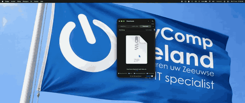

# EasyComp Keyboard Light v1.2.0 — Stable keyboard backlight release

**No Terminal commands required — choose your language and use one native Setup app.**

This stable release includes the MacBookPro15,4 Butterfly backlight protocol into the regular app and installer. Previously the installer stopped because PID `05ac:027d` was not accepted as a writable backlight interface.

I approved promotion from beta7.1 on 13 November 2026 after the successful MacBookPro15,4 follow-up. The proven HID protocol bytes and lighting state machine are unchanged. Stable release status covers manual backlight control, the timeout implementation and the native setup workflow; it does not certify original Touch Bar controls or every sleep/session edge case.

## What changed

- MacBookPro16,1 and MacBookPro15,4 are recognized models in Setup and the installer; other candidate T2 models still require experimental confirmation and protocol validation.
- The normal read-only installer probe can now accept the exact MacBookPro15,4 interface validated in issue #2. No separate test app is needed for normal installation.
- Support is restricted to model `MacBookPro15,4`, Apple `05ac:027d`, primary keyboard usage `0001/0006`, the observed BF input descriptor and exactly one matching interface.
- Every operation re-reads configuration `BF`, requiring exactly 8 bytes, version 1 and values off 0/minimum 32/maximum 512. Mismatched, inaccessible or ambiguous interfaces are refused.
- Brightness uses the existing six-byte `B0` output protocol and remains within the reported range. This update adds no report IDs, private T2 commands, PID `027b` support or broad Apple-device matching.
- The A2141/MacBookPro16,1 Magic report structures, descriptor checks and write sequence are preserved. Installer staging/rollback, settings, idle timeout, background monitoring and all eight languages are retained.

## Hardware evidence and acceptance limits

[mjesticfalco confirmed two visible minimum-light/off cycles](https://github.com/EasyCompZLD/EasyComp-Keyboard-Light---For-headless-Apple-MacBook-Pro-s-with-T2-Chip/issues/2#issuecomment-6825954957) on **MacBookPro15,4, macOS Sequoia 15.8.3 (24H241), x86_64**. Device open, BF configuration reads and B0 writes for values 32 and 0 all returned success, and the keyboard visibly lit briefly and went off.

**Hardware follow-up, 13 November 2026:** [the tester reports](https://github.com/EasyCompZLD/EasyComp-Keyboard-Light---For-headless-Apple-MacBook-Pro-s-with-T2-Chip/issues/2#issuecomment-6838177188) normal compilation, menu bar app launch, working keyboard backlight and idle timeout, and backlight response after sleep. The 10–100% steps appear to work, although some brightness differences are hard to distinguish. This is a successful integrated-app report, not a measurement of each brightness level. Exact restoration, manual-off protection, persistence, individual timeout modes and original Touch Bar controls still need explicit confirmation. Other T2 models remain experimental. Issue #2 stays open pending review of the remaining checks.

## Install and test

1. Download `EasyComp-Keyboard-Light.zip`, extract it locally and open **EasyComp Keyboard Light Setup.app**.
2. Choose your language and Install/Update. Other candidate T2 models still require the experimental compatibility confirmation; model recognition alone never bypasses HID validation. The installer validates the HID interface before installing or starting the controller.
3. On MacBookPro15,4, verify manual off/on and each 10% step, then idle restoration, app restart and sleep/wake. Share the local diagnostic report and actual observations in issue #2.

Keep a backup of the previously installed app before updating. Existing preferences are retained. The app is ad-hoc signed, not notarized; use the normal macOS opening approval if prompted.

The ZIP contains one universal Setup app with its backend bundled internally. The actual lighting controller is for Intel T2 Macs. `BUILD-INFO.txt` records the commit/source hashes, and `SHA256SUMS.txt` identifies the package.

## GUI workflow demonstration

[Full video (WebM)](https://github.com/EasyCompZLD/EasyComp-Keyboard-Light---For-headless-Apple-MacBook-Pro-s-with-T2-Chip/blob/v1.2.0/Assets/IMG_0919.webm?raw=true)

## Thanks to my testers

A special thank you to [@mjesticfalco](https://github.com/mjesticfalco) for testing on MacBookPro15,4 / Sequoia 15.8.3, sharing the read-only reports, confirming the controlled minimum/off experiment, and testing the integrated app, brightness steps, idle timeout and wake response. Your help made this compatibility update possible.

I continue testing the original A2141 / MacBookPro16,1 through EasyComp Zeeland. I will credit additional testers as their contributions are documented.
