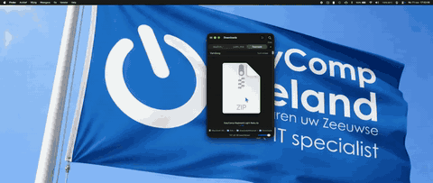

# EasyComp Keyboard Light - For headless Apple MacBook Pro’s with T2 Chip.


**No display. No ambient light sensor. Still a glowing keyboard. 💡**

A free, open-source macOS menu bar application that restores **keyboard backlight control** on headless Intel MacBook Pros equipped with Apple's T2 Security Chip.

Originally developed and tested on a **2019 16-inch MacBook Pro (A2141 / MacBookPro16,1)**, EasyComp Keyboard Light communicates directly with the keyboard's USB-HID backlight interface, bypassing the limitations of macOS CoreBrightness.

**Version 1.2.0-beta6 · macOS · Swift + C · 8 languages · MIT License · Made by EasyComp Zeeland**

[Installation](#installation) · [Video demonstration](#installation-and-live-demonstration) · [Features](#features) · [Compatibility](#compatibility) · [How it works](#how-it-works) · [Report an issue](#diagnostics-and-github-issue-reporting) · [Dutch instructions](LEESMIJ.md) · [License](LICENSE)

---

## 🎬 Installation and Live Demonstration

See EasyComp Keyboard Light being installed and used on a real headless MacBook Pro.

The demonstration shows the installation process and keyboard backlight functionality without reconnecting the original display or ambient light sensor.

<a href="Assets/EasyComp%20Keyboardlight%20install%20and%20demo.mp4">
  
</a>
## 🎬 Installation & Live Demonstration

<!-- Upload the MP4 by dragging it into GitHub's README editor.
     Replace the URL below with the generated user-attachments URL. -->

<video src="https://github.com/user-attachments/assets/REPLACE_WITH_VIDEO_ID" controls>
  <a href="Assets/EasyComp%20Keyboardlight%20install%20and%20demo.mp4">
    Watch the full installation and demonstration
  </a>
</video>

Video file: `Assets/EasyComp Keyboardlight install and demo.mp4`

The full video includes the installation procedure and a demonstration of the keyboard illumination controls.

---

## Why this exists: an unnecessary software roadblock

Remove the broken display from a MacBook Pro, and you also remove its ambient light sensor.

On our tested MacBook, **macOS then removes the normal keyboard-backlight controls**.

The original Touch Bar illumination buttons stop functioning through the usual software path, System Settings no longer provides useful keyboard brightness controls, and Apple's CoreBrightness interface fails to report a usable brightness value.

It almost feels like Apple is giving headless MacBook owners the *metaphorical middle finger*:

**No sensor? No keyboard light.**

But here's the interesting part:

**The ambient light sensor isn't actually required for the keyboard backlight LEDs to illuminate.**

We confirmed this on a real headless MacBookPro16,1. Sending the correct feature reports directly to the Apple T2 USB-HID backlight interface successfully turns the keyboard lighting on, adjusts its brightness and turns it off again.

No original display, camera or ambient light sensor needs to be reconnected.

> **macOS:** No ambient light sensor? No backlight controls.
>
> **EasyComp Keyboard Light:** Hold my HID report. 💡

This demonstrates an observed software limitation on the tested hardware. It does not establish that Apple deliberately designed the restriction to prevent headless operation, or that the ambient light sensor serves no other purpose.

**A broken display should not mean a permanently dark keyboard.**

---

## ✨ Features

### Keyboard backlight controls

- Native macOS menu bar application
- Keyboard brightness slider (0–100%)
- Brightness adjustment in 10% increments
- Instant keyboard backlight on/off control
- Automatic restoration of the last selected brightness
- Optional automatic startup when logging into macOS
- Dedicated macOS application icon
- Lightweight background operation

### Touch Bar integration

- Support for the original keyboard illumination increase/decrease events
- Independent background event listener introduced in v1.2
- Designed to handle illumination keys even when the menu bar popup is closed
- Does not interfere with standard screen brightness controls
- Menu bar controls remain available when Touch Bar events are unavailable

**Important:** The independent background listener is a beta improvement. Its effectiveness depends on whether macOS still generates the original illumination events. Additional testing across configurations is welcome.

### Installation wizard

Starting with v1.2, EasyComp Keyboard Light includes a native macOS installation wizard.

- Graphical installation interface
- One-click installation process
- Automatic Mac model detection
- Hardware compatibility checks
- Installation progress and status messages
- Automatic developer-tool detection
- Guided installation of missing Apple Command Line Tools
- Automatic opening of the compiled installation wizard
- Error handling and readable diagnostic messages
- Protection of an existing working installation when validation fails
- Direct access to GitHub Issues

**No Terminal knowledge is required for the normal installation process.**

The first launcher builds the native setup wizard locally and opens it automatically.

### Multilingual interface

The application, installation wizard and accompanying launcher commands support eight languages:

| Language | Application | Installer |
|---|---|---|
| 🇬🇧 English | ✅ | ✅ |
| 🇳🇱 Nederlands | ✅ | ✅ |
| 🇩🇪 Deutsch | ✅ | ✅ |
| 🇫🇷 Français | ✅ | ✅ |
| 🇪🇸 Español | ✅ | ✅ |
| 🇮🇹 Italiano | ✅ | ✅ |
| 🇵🇹 Português | ✅ | ✅ |
| 🇵🇱 Polski | ✅ | ✅ |

The application automatically detects the preferred macOS language. Users can also change languages manually.

### Privacy and security

- No telemetry or usage tracking
- No account registration
- No cloud services
- No network connection required for keyboard control
- No kernel extensions
- No root daemon
- No firmware modifications
- No requirement to disable System Integrity Protection (SIP)
- No requirement to disable FileVault
- No automatic uploading of diagnostic reports

The application is fully open source under the MIT License.

Settings are currently accessible through the menu bar. There is no separate settings window.

---

## 💻 Compatibility

EasyComp Keyboard Light was originally developed for a headless MacBook Pro 16-inch (2019), using an Intel processor and Apple T2 Security Chip.

### Supported and experimental hardware

| Configuration | Status |
|---|---|
| **MacBookPro16,1 / A2141** — 16-inch MacBook Pro 2019 | ✅ Direct HID backlight control confirmed |
| macOS Tahoe 26 on A2141 | ✅ Tested HID method |
| Other Intel MacBook Pros with T2 | 🧪 Experimental |
| Intel MacBook Air with T2 | 🧪 Experimental |
| Apple Silicon MacBooks | ❌ Not supported |
| FileVault pre-boot environment | ❌ Not available |

**The A2141 remains the primary validated hardware platform.**

Other T2-equipped MacBooks may use different HID interfaces, report formats or keyboard hardware.

Experimental support is being investigated for additional models, including MacBooks with Butterfly keyboards.

The installer performs a read-only HID protocol check before attempting hardware control.

For unverified models, installation requires explicit experimental opt-in and successful protocol detection. A successful probe does not guarantee that the keyboard LEDs will illuminate.

We welcome reports from owners of other T2-equipped MacBooks.

---

## 📦 Installation

EasyComp Keyboard Light is distributed as open-source software.

The current release package contains the source code, multilingual installation scripts, graphical wizard source, documentation and diagnostic tools.

**A precompiled, Apple-notarized `.app` or `.dmg` is not currently provided.**

### Recommended installation — graphical wizard

**Step 1 — Download**

Visit the [GitHub Releases page](https://github.com/EasyCompZLD/EasyComp-Keyboard-Light---For-headless-Apple-MacBook-Pro-s-with-T2-Chip/releases).

Download the latest release ZIP and extract the complete archive.

We recommend the attached release ZIP rather than GitHub's automatically generated source archive because executable permissions for `.command` files may not be preserved by GitHub web uploads.

**Step 2 — Choose your language**

Double-click the installer corresponding to your language:

| Language | Installation file |
|---|---|
| Automatic macOS language | `Install.command` |
| English | `Install - English.command` |
| Nederlands | `Installeren - Nederlands.command` |
| Deutsch | `Installieren - Deutsch.command` |
| Français | `Installer - Français.command` |
| Español | `Instalar - Español.command` |
| Italiano | `Installa - Italiano.command` |
| Português | `Instalar - Português.command` |
| Polski | `Zainstaluj - Polski.command` |

All launchers use the same underlying installer.

**Step 3 — Automatic setup**

The installer will:

1. Detect your macOS environment and available developer tools.
2. Use an existing Apple Xcode or Command Line Tools installation.
3. Offer Apple's official Command Line Tools installation when required.
4. Compile and automatically open the native installation wizard.
5. Let you review the detected hardware and start installation.
6. Compile and validate the EasyComp Keyboard Light application.
7. Install the application while preserving existing preferences.

If Apple needs to install developer tools, macOS may request your approval or license acceptance.

There is no need to install the full Xcode application if the Apple Command Line Tools are available.

**Step 4 — Start using EasyComp Keyboard Light**

After successful installation, find the keyboard icon in the macOS menu bar.

The application is installed at:

`~/Applications/EasyComp Keyboard Light.app`

Click the menu bar icon to adjust keyboard brightness, turn the backlight on or off, change language and configure automatic startup.

### macOS security warning

Because the project is distributed as locally compiled open-source software and is not Developer ID-signed or notarized, macOS may display a security warning when opening a downloaded installer.

Review the source code before running it. If you trust the downloaded project, use the appropriate macOS security controls to allow it to open.

Do not disable SIP or FileVault.

### Terminal installation — advanced users

Users who prefer Terminal can run:

```bash
bash Controleer-build.command
bash Installeer.command
```

Run these commands from the extracted project directory.

Do not run the installer with `sudo`.

### Experimental hardware installation

Owners of other potentially compatible Intel T2 MacBooks should first perform the read-only hardware check:

```bash
bash Diagnoseer-T2-Mac.command
```

The experimental installation path is:

```bash
bash Installeer.command --experimental
```

**Warning:** This is intended for voluntary compatibility testing. Experimental hardware support is not yet guaranteed to work.

---

## ⚙️ Automatic prerequisites

EasyComp Keyboard Light checks for the Apple tools required to compile the application locally.

### Existing Xcode installation

If Xcode is installed, the installer uses the available Apple `clang` and `swiftc` compilers.

It does not unnecessarily install a second copy of the developer tools.

### Missing developer tools

If neither a usable Xcode installation nor Apple Command Line Tools can be found, the installer starts Apple's official installation procedure.

After the user completes Apple's installation prompts, the installer attempts to continue automatically.

If Xcode requires first-launch configuration or license acceptance, the installer reports that separately.

The installer does not bypass Apple's system security or permission requirements.

---

## 🔄 Updating

Download and extract the newer release, then open the appropriate language-specific installation launcher.

The installer builds and validates the new application before replacing the existing version.

Existing settings, including the preferred brightness and language, are preserved.

If validation fails, the installer is designed to leave the existing working installation untouched or recover it when possible.

A rebuilt application may require renewed macOS Input Monitoring permission for Touch Bar illumination events.

---

## 🗑️ Uninstall

Use the translated uninstall command in the `Languages` directory, or run:

```bash
bash Verwijder.command
```

The uninstall launcher requests confirmation.

The application and its automatic login configuration are removed. Saved user preferences may remain available for a later installation.

---

## 🔧 How it works

The keyboard backlight on the tested MacBook Pro can be controlled through an Apple T2 USB-HID interface.

Instead of relying on the normal CoreBrightness framework, EasyComp Keyboard Light uses native macOS IOKit HID functions.

Before sending commands, the application checks the device and its HID feature report descriptors.

### Confirmed A2141 HID interface

| Property | Value |
|---|---|
| Vendor ID | `0x05AC` (Apple) |
| Product ID | `0x8102` |
| Usage Page | `0xFF00` |
| Usage | `0x000F` |
| Power Feature Report | ID `3`, 6 bytes |
| Brightness Feature Report | ID `1`, 9 bytes |
| Brightness Descriptor Range | `100–14660` |

On our headless MacBook Pro, the normal CoreBrightness interface returned `-1.0000` when attempting to read the keyboard brightness.

However, direct HID feature reports successfully controlled the keyboard LEDs.

This proves that **the ambient light sensor is not required for direct keyboard illumination control on the tested A2141 hardware**.

The application performs no SMC register modifications and does not alter firmware.

### Other T2 keyboard interfaces

Not all T2 MacBooks use identical keyboard hardware or HID protocols.

Recent experimental versions include additional HID protocol detection intended to support different T2 keyboard configurations.

These paths are still under development and must be tested on real hardware.

**A compatibility report from an unsupported Mac is more useful than blindly attempting hardware commands.**

---

## ⌨️ Touch Bar controls and background operation

The original Touch Bar keyboard illumination buttons normally communicate with macOS through system-defined keyboard illumination events.

EasyComp Keyboard Light listens for these specific events:

- Keyboard illumination increase
- Keyboard illumination decrease
- Keyboard illumination toggle

These are separate from ordinary typing events.

### Background improvements in v1.2

The v1.2 branch introduces an independent event-listening run loop.

The goal is to allow keyboard illumination commands to continue being processed while the menu bar popup is closed.

This addresses an issue observed during development where Touch Bar controls appeared to work only when the menu was open.

**Further real-world testing is required to confirm the fix across different macOS configurations.**

If macOS does not generate the original illumination events, direct menu bar controls remain available.

macOS may request Input Monitoring permission for event listening.

---

## 🌍 Languages and localized commands

EasyComp Keyboard Light supports eight user interface languages.

The macOS menu bar application and graphical installer can automatically select a language based on system preferences.

Users can also select a language manually.

Additionally, the project contains a `Languages` directory with localized commands for:

- Installation
- Build verification
- Hardware compatibility checking
- Diagnostic report generation
- Uninstallation

For example:

`Languages/English/Diagnostic Report.command`

`Languages/Nederlands/Probleemrapport.command`

`Languages/Deutsch/Hardware prüfen.command`

These files use the same underlying scripts. This ensures fixes and improvements are shared across all translations.

Application translations are stored in:

`broncode/Localizations/*.lproj/Localizable.strings`

Contributions and translation improvements are welcome.

---

## 🩺 Diagnostics and GitHub Issue Reporting

One of the main goals of the v1.2 development branch is to improve compatibility across additional Intel T2 MacBooks.

For that reason, the installer includes automatic diagnostic reporting.

### What happens when installation fails?

If the installation is refused or fails, the installer attempts to create a local diagnostic report in the user's Downloads folder.

The report can include:

- EasyComp Keyboard Light version
- Mac model identifier
- macOS version and build
- CPU architecture
- Installation stage and exit code
- Missing or incorrectly configured prerequisites
- Compiler errors
- Read-only HID interface information
- HID feature report descriptors
- Relevant diagnostic log messages

This helps developers distinguish unsupported hardware from installation errors, missing permissions and unexpected HID behavior.

### Report an issue

Users can generate a report manually at any time:

```bash
bash Probleemrapport.command
```

Or perform a read-only hardware compatibility scan:

```bash
bash Diagnoseer-T2-Mac.command
```

**[Open a new GitHub compatibility or installation issue](https://github.com/EasyCompZLD/EasyComp-Keyboard-Light---For-headless-Apple-MacBook-Pro-s-with-T2-Chip/issues/new?template=installation_failure.md)**

When reporting a problem, please include:

- Your Mac model identifier
- Your macOS version
- The generated diagnostic report
- Whether the keyboard LEDs physically illuminated
- Whether brightness adjustment worked
- Whether Touch Bar illumination controls worked with the menu open and closed

### Privacy

Diagnostic reports are generated locally.

The software does **not** automatically upload reports to GitHub or any other service.

Known personal information patterns are filtered where possible, but automated redaction is best-effort.

**Always review a diagnostic report before publishing it. Never share passwords, serial numbers, hardware UUIDs or personal information.**

---

## 📁 Project layout

| File or directory | Purpose |
|---|---|
| `broncode/EasyCompKeyboardLight.swift` | Native macOS menu bar application |
| `broncode/HIDBacklight.c` | HID detection and keyboard backlight control |
| `broncode/InstallWizard.swift` | Native graphical installation wizard |
| `broncode/Info.plist` | Application metadata |
| `broncode/Localizations/` | Eight application translations |
| `scripts/developer-tools.sh` | Apple developer-tool detection and setup |
| `scripts/cli-i18n.sh` | Localization for command-line launchers |
| `Languages/` | Localized installation and diagnostic commands |
| `Assets/AppIcon.svg` | Editable application icon |
| `Assets/AppIcon.png` | Application icon image |
| `Assets/AppIcon.iconset/` | macOS application icon resources |
| `Assets/IMG_0919.gif` | Animated keyboard backlight demonstration |
| `Assets/EasyComp Keyboardlight install and demo.mp4` | Full installation and demonstration video |
| `Start-Installatie.command` | Builds and automatically opens the graphical wizard |
| `Install.command` | Automatic-language installer launcher |
| `Installeer.command` | Core installation script |
| `Controleer-build.command` | Build verification |
| `Diagnoseer-T2-Mac.command` | Read-only hardware diagnosis |
| `Probleemrapport.command` | Local diagnostic report and issue assistance |
| `Verwijder.command` | Uninstallation |
| `.github/ISSUE_TEMPLATE/installation_failure.md` | GitHub installation and compatibility issue template |
| `.github/workflows/build.yml` | Automated build verification |
| `tests/` | Installer and regression tests |
| `LEESMIJ.md` | Dutch documentation |
| `START-HERE.md` | Multilingual starting instructions |
| `CONTRIBUTING.md` | Contribution guidelines |
| `LICENSE` | MIT License |

---

## 🧪 Development status

### Stable release: v1.1.0

The original keyboard backlight solution has been successfully tested on a headless MacBook Pro A2141.

This version established working direct USB-HID control without the ambient light sensor.

### Current development release: v1.2.0-beta6

The v1.2 development branch introduces:

- A graphical installation wizard
- Eight-language installation and support tools
- Automatic Apple developer-tool detection
- Guided prerequisite installation
- HID detection regression fixes
- Experimental support for additional Intel T2 Macs
- Improved Touch Bar background event handling
- Automatic local diagnostic reports
- GitHub issue reporting integration
- Safer application replacement during updates
- Installation and demonstration video documentation

The installation process has been tested on the original A2141 development machine.

**Additional T2 hardware support and the background Touch Bar improvement remain experimental until verified on more devices.**

Please use the beta release for testing and keep reporting your findings.

---

## 🤝 Contributing

Contributions, bug reports, testing and translations are welcome!

We are particularly interested in hearing from people using:

- Headless Intel MacBook Pros
- Intel MacBook Air models with Apple's T2 Security Chip
- MacBooks with Butterfly keyboards
- Different macOS versions
- External monitor setups

If your keyboard backlight stops working after removing a MacBook display, please share the model identifier and diagnostic results.

You do not need to be a software developer to help. Even reporting that the application fails to detect a specific model can provide valuable information.

Read [CONTRIBUTING.md](CONTRIBUTING.md) before submitting a pull request.

**[GitHub Issues](https://github.com/EasyCompZLD/EasyComp-Keyboard-Light---For-headless-Apple-MacBook-Pro-s-with-T2-Chip/issues)**

---

## 📜 License and disclaimer

Released under the [MIT License](LICENSE).

Copyright © 2026 **EasyComp Zeeland**.

EasyComp Keyboard Light is an independent community project developed by EasyComp Zeeland in the Netherlands.

This software is **not affiliated with, endorsed by or supported by Apple Inc.**

Apple, MacBook Pro, macOS, Touch Bar and related trademarks belong to their respective owners.

Hardware modifications, unsupported installations and experimental compatibility testing are performed at the user's own risk.

---

## ❤️ About EasyComp Zeeland

EasyComp Zeeland develops practical IT solutions, software, infrastructure tools and technology projects.

EasyComp Keyboard Light started as a personal solution to a frustrating limitation encountered while converting a defective MacBook Pro into a useful headless computer.

Rather than keeping the workaround private, we decided to release the source code so other MacBook owners could benefit from it.

**Website:** https://easycompzeeland.nl

**GitHub:** https://github.com/EasyCompZLD

---

**No display. No light sensor. No problem.**

**EasyComp Keyboard Light — Bringing light back to headless MacBooks. 💡**
