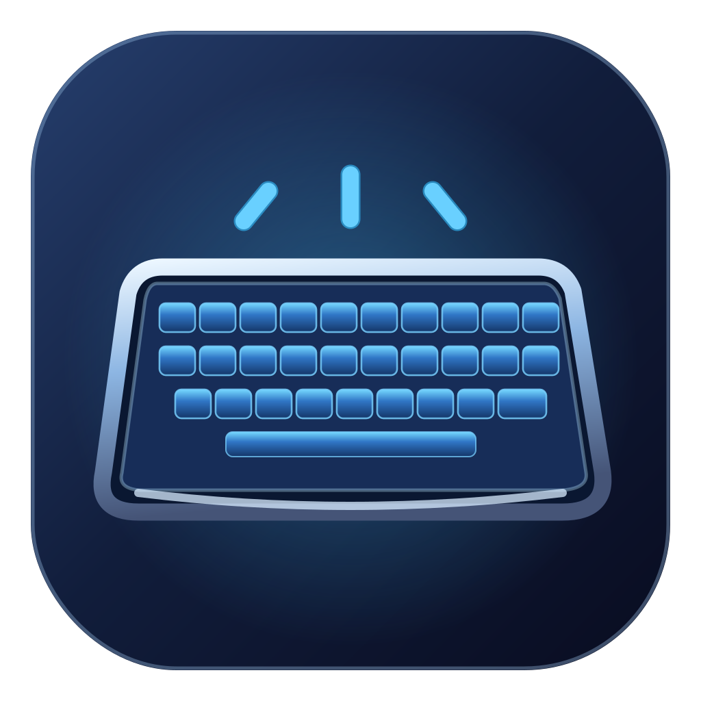
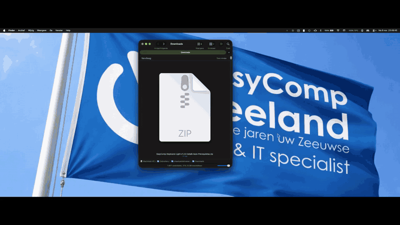

# EasyComp Keyboard Light - For headless Apple MacBook Pro’s with T2 Chip



**No display. No ambient light sensor. Still a glowing keyboard. 💡**

EasyComp Keyboard Light is a free, open-source macOS menu bar application designed to restore **keyboard backlight control on headless Intel MacBooks equipped with Apple's T2 Security Chip**.

Originally developed and successfully tested on a **2019 16-inch MacBook Pro (A2141 / MacBookPro16,1)**, the application communicates directly with the keyboard backlight's USB-HID interface instead of relying on macOS CoreBrightness.

**Version 1.2.0-beta6 · macOS · Swift + C · 8 languages · MIT License · Developed by EasyComp Zeeland**

[Installation](#installation) · [Demonstration](#installation-and-live-demonstration) · [Features](#features) · [Compatibility](#compatibility) · [How it works](#how-it-works) · [Diagnostics](#diagnostics-and-github-issue-reporting) · [GitHub Releases](../../releases) · [License](LICENSE)

---

## 🎬 Installation and Live Demonstration

**See EasyComp Keyboard Light in action on a real headless MacBook Pro!**

This demonstration shows the installation process, the native menu bar application and the keyboard backlight being controlled without reconnecting the original display or ambient light sensor.



**▶ [Watch or download the full installation and demonstration video (MP4)](Assets/EasyComp%20Keyboardlight%20install%20and%20demo.mp4)**

The GIF is embedded directly in this README. The full-length video provides a more detailed demonstration of the installation and the application's functionality.

---

## Why this exists: an unnecessary software roadblock

Removing a broken display from a MacBook Pro is a popular way to give an otherwise functional machine a second life.

Connect an external monitor, keyboard or mouse, and you can continue using a powerful Mac without replacing an expensive or damaged display assembly.

Unfortunately, Apple made one part of this process unnecessarily complicated.

On our tested MacBook, removing the display also removed the ambient light sensor. As a result, **macOS stopped providing normal keyboard backlight controls**.

The keyboard illumination controls disappeared from System Settings, the original Touch Bar buttons stopped working through the normal macOS interface, and Apple's CoreBrightness framework could no longer report a usable brightness value.

It almost feels like Apple is giving headless MacBook owners the *metaphorical middle finger*:

**No sensor? No keyboard light.**

But this raised an important question:

**Why should the keyboard LEDs need an ambient light sensor just to turn on?**

The ambient light sensor measures environmental brightness. It does not physically power the keyboard illumination LEDs.

After investigating Apple's T2-connected USB-HID interfaces, we discovered that the keyboard backlight could still be controlled directly.

On our headless MacBook Pro 16-inch (2019), the correct USB-HID feature reports successfully:

- Turn the keyboard backlight on
- Adjust the keyboard illumination brightness
- Turn the keyboard backlight off

All without reconnecting the original display or ambient light sensor.

> **macOS:** No ambient light sensor? No keyboard backlight controls.
>
> **EasyComp Keyboard Light:** Hold my HID report. 💡

This demonstrates a software limitation on the tested hardware. It does not establish that Apple deliberately designed this behavior to prevent headless operation, nor that the ambient light sensor serves no other purpose.

**A broken display should not mean a permanently dark keyboard.**

---

## ✨ Features

### Native keyboard backlight controls

- Native macOS menu bar application
- Keyboard backlight brightness slider
- Adjustable brightness from 0% to 100%
- Brightness increase and decrease in 10% steps
- Instant keyboard backlight on/off control
- Automatically restore the previously selected brightness
- Optional automatic startup after macOS login
- Dedicated application icon
- Lightweight operation without a cloud connection

### Original Touch Bar support

EasyComp Keyboard Light can process the original keyboard illumination events generated by macOS.

Supported event types include:

- Keyboard illumination increase
- Keyboard illumination decrease
- Keyboard illumination toggle

Version 1.2 introduces an independent background event listener, designed to keep Touch Bar illumination controls responsive even when the menu bar popup is closed.

**Important:** This background improvement is still being tested. Touch Bar operation depends on macOS continuing to generate the relevant illumination key events.

The native menu bar controls remain available independently of the original Touch Bar buttons.

### Graphical installation wizard

Version 1.2 introduces a native macOS installation wizard.

The wizard is designed for users who are not familiar with Terminal, compilers or hardware interfaces.

It provides:

- Graphical installation interface
- Installation progress and status messages
- Automatic Mac model detection
- Hardware compatibility checks
- Detection of existing Apple developer tools
- Guided installation of missing prerequisites
- Automatic launching of the graphical wizard
- Clear installation error messages
- Local developer diagnostic reports
- Direct access to GitHub Issues
- Protection of an existing working installation during failed upgrades

**The normal installation workflow does not require users to enter Terminal commands manually.**

The first launcher compiles the native installation wizard locally using Apple's developer tools and then opens it automatically.

### Multilingual interface and installation

EasyComp Keyboard Light supports eight languages throughout the application and graphical installer.

| Language | Application | Installation Wizard | Localized Commands |
|---|---|---|---|
| 🇬🇧 English | ✅ | ✅ | ✅ |
| 🇳🇱 Nederlands | ✅ | ✅ | ✅ |
| 🇩🇪 Deutsch | ✅ | ✅ | ✅ |
| 🇫🇷 Français | ✅ | ✅ | ✅ |
| 🇪🇸 Español | ✅ | ✅ | ✅ |
| 🇮🇹 Italiano | ✅ | ✅ | ✅ |
| 🇵🇹 Português | ✅ | ✅ | ✅ |
| 🇵🇱 Polski | ✅ | ✅ | ✅ |

The application automatically detects the preferred macOS language.

Users can also change the language manually.

Each supported language has its own collection of recognizable installation, diagnostic, build verification and uninstallation commands.

All language-specific launchers use the same underlying code, ensuring that fixes and improvements apply across all languages.

### Privacy and security

EasyComp Keyboard Light is designed to operate locally.

- No telemetry
- No analytics
- No user registration
- No account required
- No cloud services
- No internet connection required for normal keyboard control
- No kernel extensions
- No root daemon
- No firmware modification
- No requirement to disable System Integrity Protection (SIP)
- No requirement to disable FileVault
- No automatic uploading of diagnostic reports

The application is fully open source and licensed under the MIT License.

**Note:** Application settings are currently accessible through the macOS menu bar. There is no separate settings window.

---

## 💻 Compatibility

EasyComp Keyboard Light was originally developed for a headless 2019 MacBook Pro 16-inch with an Intel processor and Apple T2 Security Chip.

### Supported and experimental hardware

| Configuration | Support Status |
|---|---|
| **MacBookPro16,1 / A2141** — MacBook Pro 16-inch (2019) | ✅ Confirmed HID backlight control |
| macOS Tahoe 26 on A2141 | ✅ Tested |
| Other Intel MacBook Pros with Apple T2 | 🧪 Experimental |
| Intel MacBook Air models with Apple T2 | 🧪 Experimental |
| MacBooks with Butterfly keyboards | 🧪 Experimental protocol support |
| Apple Silicon MacBooks | ❌ Not supported |
| FileVault pre-boot environment | ❌ Not supported |

### Confirmed working configuration

Our primary development and testing machine is:

- **Mac:** Apple MacBook Pro 16-inch (2019)
- **Model identifier:** MacBookPro16,1
- **Model number:** A2141
- **Processor:** Intel Core i9
- **Security chip:** Apple T2
- **Operating system:** macOS Tahoe 26
- **Configuration:** Headless, with the display assembly removed

The original HID backlight control method has been confirmed on this hardware.

### Experimental T2 compatibility

Other T2-equipped MacBooks may use different keyboard hardware, HID interfaces and feature reports.

In particular, some older T2 MacBooks with Butterfly keyboards use different interfaces from the later Magic Keyboard models.

Version 1.2 includes experimental detection and support for additional HID protocols.

The installer performs a hardware and protocol check before attempting to control the keyboard backlight.

**Experimental support does not mean that a particular MacBook model has already been verified to work.**

We encourage owners of other T2-equipped MacBooks to submit compatibility reports.

Successful detection, failed installation attempts and actual keyboard illumination results can all help improve support.

---

## 📦 Installation

EasyComp Keyboard Light is distributed as open-source software.

The release package includes the source code, native installation wizard, multilingual commands, documentation and diagnostic utilities.

A precompiled, Apple-notarized `.app` or `.dmg` is not currently distributed.

### Recommended installation — graphical wizard

**Step 1 — Download the latest release**

Visit:

**[EasyComp Keyboard Light — GitHub Releases](../../releases)**

Download the appropriate release ZIP from the release's Assets section.

Extract the complete ZIP archive before opening the installer.

We recommend using the attached release ZIP rather than GitHub's automatically generated source archive, because executable permissions on `.command` files may not be preserved by manual web uploads.

**Step 2 — Start the installer**

For English-speaking users, double-click:

`Install - English.command`

Alternatively, use:

`Languages/English/Install.command`

For automatic language selection, use:

`Install.command`

You can also select an installer in your preferred language:

| Language | Installation Launcher |
|---|---|
| Automatic | `Install.command` |
| English | `Install - English.command` |
| Nederlands | `Languages/Nederlands/Installeren.command` |
| Deutsch | `Languages/Deutsch/Installieren.command` |
| Français | `Languages/Français/Installer.command` |
| Español | `Languages/Español/Instalar.command` |
| Italiano | `Languages/Italiano/Installa.command` |
| Português | `Languages/Português/Instalar.command` |
| Polski | `Languages/Polski/Zainstaluj.command` |

**Step 3 — Follow the installation wizard**

The installer will:

1. Detect the macOS environment.
2. Check for Apple developer tools.
3. Use an existing Xcode installation or Apple Command Line Tools when available.
4. Offer Apple's official developer-tools installation when required.
5. Build and launch the native graphical installation wizard.
6. Detect the Mac model and inspect the relevant hardware.
7. Verify the available HID backlight protocol.
8. Compile the application and perform installation checks.
9. Install EasyComp Keyboard Light while preserving existing preferences.

If Apple needs to install missing developer tools, macOS may ask the user to approve the installation or accept Apple's license terms.

The installer does not bypass these macOS requirements.

**Step 4 — Start using EasyComp Keyboard Light**

After a successful installation, the application is installed in:

`~/Applications/EasyComp Keyboard Light.app`

Look for the keyboard icon in the macOS menu bar.

Click the icon to:

- Adjust keyboard illumination
- Turn the keyboard backlight on or off
- Increase or decrease brightness
- Change the application language
- Manage automatic startup
- Access relevant macOS privacy settings

### macOS security warning

EasyComp Keyboard Light is not currently distributed as an Apple Developer ID-signed and notarized application.

macOS may therefore display a warning when opening downloaded installation files.

Review the source code and ensure you trust the project before granting permission to open the installer.

Depending on the macOS version, you may need to use Finder's **Open** option or approve the application under **System Settings → Privacy & Security**.

Do not disable System Integrity Protection or FileVault.

### Installation from Terminal — advanced users

The English-language launcher can also be started from Terminal:

```bash
bash "Install - English.command"
```

For a build check:

```bash
bash "Languages/English/Check Build.command"
```

Run these commands from the extracted project directory.

Do not run the installer using `sudo`.

---

## ⚙️ Automatic prerequisites

EasyComp Keyboard Light compiles its native Swift and C components locally on the user's Mac.

This requires Apple's developer tools.

### Existing Xcode installation

If a usable Xcode installation already exists, the installer uses the available `clang` and `swiftc` compilers.

It does not unnecessarily download or reinstall the separate Command Line Tools.

### Existing Apple Command Line Tools

If the standalone Apple Command Line Tools are available, the installer uses them directly.

The full Xcode application is **not required**.

### Missing developer tools

If neither a usable Xcode installation nor Apple Command Line Tools can be found, the installer starts Apple's official installation process.

The user may need to approve the Apple installer and complete any required license steps.

Once the tools become available, the installation process attempts to continue automatically.

If Xcode is present but requires additional configuration or license acceptance, that condition is reported separately rather than incorrectly treating the tools as missing.

---

## 🔄 Updating

To update EasyComp Keyboard Light:

1. Download the latest release ZIP.
2. Extract the complete archive.
3. Double-click `Install - English.command`, or choose your preferred language.
4. Follow the installation wizard.

The installer checks and builds the updated application before replacing the existing installation.

Existing application preferences, including brightness and language selection, are preserved where possible.

If an update fails during validation, the installer is designed to leave the previous working installation untouched.

A rebuilt application may require renewed Input Monitoring permission for Touch Bar illumination event handling.

---

## 🗑️ Uninstallation

To remove EasyComp Keyboard Light, open:

`Languages/English/Uninstall.command`

Or select the equivalent command in your preferred language.

The uninstaller asks for confirmation before removing the application.

The installed app and its automatic login configuration are removed.

User preferences may remain available for future installations.

---

## 🔧 How it works

EasyComp Keyboard Light communicates directly with the Apple T2-connected USB-HID keyboard backlight interface.

This avoids relying on the normal macOS CoreBrightness control path, which may stop functioning when the display assembly and ambient light sensor are removed.

The application uses Apple's native IOKit HID APIs.

Before sending commands, the HID helper validates the detected device and its feature report descriptors.

### Confirmed A2141 HID interface

| Property | Value |
|---|---|
| Vendor ID | `0x05AC` (Apple) |
| Product ID | `0x8102` |
| Usage Page | `0xFF00` |
| Usage | `0x000F` |
| Power Feature Report | ID `3` — 6 bytes |
| Brightness Feature Report | ID `1` — 9 bytes |
| Brightness Descriptor Range | `100–14660` |

On our test MacBook, the normal CoreBrightness interface returned `-1.0000` when attempting to read keyboard brightness after the display was removed.

However, direct HID feature reports successfully turned the keyboard LEDs on and off and adjusted their brightness.

This confirms that **the ambient light sensor is not required to illuminate the keyboard LEDs directly on the tested A2141 hardware**.

The application does not modify firmware or write to SMC registers.

### Different keyboard hardware

Not every Intel T2 MacBook uses the same HID device or keyboard backlight protocol.

This is why support for additional models requires actual hardware testing and inspection of HID descriptors.

Version 1.2 introduces experimental support for additional protocols, while retaining the previously confirmed A2141 method.

Unsupported devices should not be forced to use the A2141 report format without validation.

---

## ⌨️ Touch Bar controls and background operation

The original Touch Bar keyboard illumination buttons can produce macOS system-defined illumination events.

EasyComp Keyboard Light can listen for these specific commands and translate them into direct HID brightness operations.

### Background event handling

Version 1.2 introduces an independent background event listener.

The goal is to keep the original illumination buttons responsive even when the menu bar popup is closed.

This improvement addresses a behavior observed during development where illumination commands were not always handled unless the application's menu was open.

The background listener is independent of the menu bar popup.

**Touch Bar behavior still depends on macOS delivering the relevant illumination events. Additional testing is welcome.**

If those events are unavailable, the application can still control the keyboard illumination directly through its menu bar interface.

### Input Monitoring permission

macOS may request Input Monitoring or Accessibility permission for keyboard event handling.

The application is designed to process the specific system-defined keyboard illumination events rather than ordinary typing events.

No typed text is collected or transmitted.

---

## 🌍 Languages and localized commands

The application supports eight languages:

English, Dutch, German, French, Spanish, Italian, Portuguese and Polish.

By default, the application follows the preferred macOS language.

Users can also select a language manually through the application menu.

The installation wizard provides the same language options.

### Localized utilities

Each language directory includes commands for:

- Installing the application
- Checking the application build
- Performing a read-only hardware check
- Generating a diagnostic report
- Uninstalling the application

For English-speaking users:

| Command | Purpose |
|---|---|
| `Languages/English/Install.command` | Open the installer |
| `Languages/English/Check Build.command` | Verify compilation |
| `Languages/English/Read-only Hardware Check.command` | Inspect hardware compatibility |
| `Languages/English/Diagnostic Report.command` | Generate a diagnostic report |
| `Languages/English/Uninstall.command` | Remove the application |

Equivalent commands are provided in all other supported languages.

### Translation files

Application translations:

`broncode/Localizations/`

Wizard translations:

`broncode/WizardLocalizations/`

Language-specific launchers:

`Languages/`

Contributions and proofreading are welcome.

---

## 🩺 Diagnostics and GitHub Issue Reporting

A major goal of the v1.2 development branch is to improve support for additional T2 MacBook models.

To make this possible, EasyComp Keyboard Light includes an installation diagnostic system.

### Automatic failure reports

If installation fails or hardware support is refused, the installer attempts to generate a local report.

The report can include:

- Application version
- Mac model identifier
- macOS version and build
- CPU architecture
- Installation stage
- Error and exit codes
- Compiler availability
- Relevant compiler errors
- Read-only HID detection information
- HID report descriptor information
- Relevant installer log messages

Reports are intended to provide actionable technical information without requiring users to understand the underlying HID protocol.

### Generate a report manually

English-language diagnostic command:

`Languages/English/Diagnostic Report.command`

To inspect the hardware without sending backlight control commands:

`Languages/English/Read-only Hardware Check.command`

Equivalent commands are available in the other language directories.

### Submit a GitHub issue

**[Open a new installation or compatibility issue](https://github.com/EasyCompZLD/EasyComp-Keyboard-Light---For-headless-Apple-MacBook-Pro-s-with-T2-Chip/issues/new?template=installation_failure.md)**

Please include:

- Your Mac model identifier
- Your macOS version
- The generated diagnostic report
- Whether the installation completed
- Whether the keyboard LEDs physically turned on
- Whether keyboard brightness adjustments worked
- Whether the original Touch Bar controls worked with the menu open
- Whether the Touch Bar controls worked with the menu closed

Reports from unsupported models are especially valuable.

### Diagnostic privacy

Diagnostic reports are created locally.

The application does not automatically upload diagnostic data to GitHub or any other service.

Known patterns for personal information are filtered where possible.

However, automatic redaction is best-effort.

**Always review diagnostic reports before publishing them.**

Never share passwords, serial numbers, hardware UUIDs, personal addresses or other private information.

---

## 📁 Project layout

| File or Directory | Description |
|---|---|
| `broncode/EasyCompKeyboardLight.swift` | Native macOS menu bar application |
| `broncode/HIDBacklight.c` | HID protocol validation and keyboard backlight control |
| `broncode/InstallWizard.swift` | Graphical macOS installation wizard |
| `broncode/Info.plist` | Application metadata |
| `broncode/Localizations/` | Eight application translations |
| `broncode/WizardLocalizations/` | Eight installation wizard translations |
| `scripts/developer-tools.sh` | Apple developer-tools detection and prerequisite handling |
| `scripts/cli-i18n.sh` | Command-line localization |
| `Languages/` | Localized installation and support commands |
| `Assets/AppIcon.svg` | Editable application icon source |
| `Assets/AppIcon.png` | Application icon |
| `Assets/AppIcon.iconset/` | macOS icon resources |
| `Assets/EasyComp-KeyboardLight-Demo.gif` | Embedded installation and demonstration GIF |
| `Assets/EasyComp Keyboardlight install and demo.mp4` | Full installation and demonstration video |
| `Install - English.command` | English graphical installer launcher |
| `Install.command` | Automatic-language installer launcher |
| `Start-Installatie.command` | Internal graphical wizard launcher |
| `Installeer.command` | Core installation implementation |
| `Controleer-build.command` | Core build verification |
| `Diagnoseer-T2-Mac.command` | Core read-only hardware diagnostic |
| `Probleemrapport.command` | Core diagnostic report generation |
| `Verwijder.command` | Core uninstallation implementation |
| `.github/ISSUE_TEMPLATE/installation_failure.md` | GitHub installation and compatibility issue template |
| `.github/workflows/build.yml` | Automated build verification |
| `tests/` | Automated installer and regression tests |
| `README.md` | Main English project documentation |
| `LEESMIJ.md` | Dutch documentation |
| `START-HERE.md` | Multilingual starting instructions |
| `CONTRIBUTING.md` | Contribution guidelines |
| `LICENSE` | MIT License |

---

## 🧪 Development status

### Stable release — v1.1.0

Version 1.1.0 established the working direct HID control method for the headless 2019 16-inch MacBook Pro A2141.

The confirmed functionality includes:

- Keyboard illumination on/off
- Direct brightness adjustment
- Native macOS menu bar controls
- Saved brightness preferences
- Eight application interface languages

### Development release — v1.2.0-beta6

Version 1.2.0-beta6 introduces:

- Native graphical installation wizard
- One-click installation launchers
- Eight-language installation support
- Localized command-line utilities
- Automatic Apple developer-tool detection
- Guided prerequisite installation
- Improved installer error handling
- HID detection regression fixes
- Experimental support for additional Intel T2 MacBooks
- Improved Touch Bar background event handling
- Local diagnostic reports
- GitHub Issue integration
- Safer upgrade procedures
- Installation and demonstration video

The beta6 installation workflow has been successfully tested on the original A2141 development machine.

**Support for additional T2 hardware and the revised background Touch Bar behavior remain experimental until further device testing confirms compatibility.**

Users are encouraged to submit feedback and diagnostic reports.

---

## 🤝 Contributing

We welcome contributions from the macOS, repair, headless MacBook and open-source communities.

We are especially interested in:

- Compatibility testing on other Intel T2 MacBooks
- Testing on MacBooks with Butterfly keyboards
- HID protocol research
- Reports from different macOS releases
- Touch Bar event handling improvements
- Installation wizard improvements
- Additional accessibility improvements
- Translation corrections
- Documentation improvements

You do not need to be a developer to contribute.

Even an installation failure report from an unsupported MacBook can help identify the differences between T2 keyboard interfaces.

Please read [CONTRIBUTING.md](CONTRIBUTING.md) before submitting a pull request.

**[Report an issue or share your findings](https://github.com/EasyCompZLD/EasyComp-Keyboard-Light---For-headless-Apple-MacBook-Pro-s-with-T2-Chip/issues)**

---

## 📜 License and disclaimer

EasyComp Keyboard Light is released under the [MIT License](LICENSE).

Copyright © 2026 **EasyComp Zeeland**.

This is independent community software and is **not affiliated with, endorsed by or supported by Apple Inc.**

Apple, MacBook Pro, macOS, Touch Bar and related names are trademarks of their respective owners.

Hardware modifications, unsupported installations and experimental compatibility tests are performed at the user's own risk.

The developers cannot guarantee compatibility with every MacBook model, firmware revision or macOS version.

---

## ❤️ About EasyComp Zeeland

EasyComp Zeeland develops practical IT solutions, software, infrastructure tools and technology projects in the Netherlands.

EasyComp Keyboard Light started as a solution to a frustrating problem encountered while converting a damaged MacBook Pro into a useful headless computer.

Rather than keeping the solution private, we decided to publish the source code so other MacBook owners could benefit from it.

**Website:** https://easycompzeeland.nl

**GitHub:** https://github.com/EasyCompZLD

---

**No display. No light sensor. No problem.**

**EasyComp Keyboard Light — Bringing light back to headless MacBooks. 💡**
